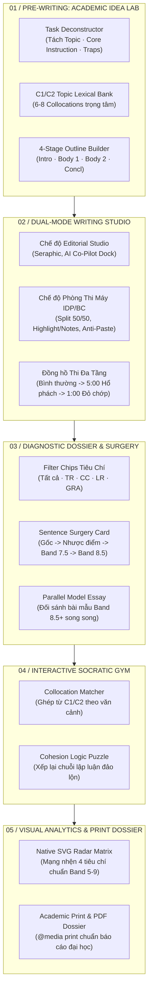

# Đặc tả Thiết kế Toàn diện: WMR IELTS Supercharged 2.0 (Full-Cycle Academy)

- **Ngày khởi tạo:** 2026-10-16
- **Tác giả:** Antigravity AI Assistant & WMR Engineering Team
- **Trạng thái:** Design In-Progress & User Review
- **Mục tiêu:** Nâng cấp WMR Writing Mentor thành Hệ sinh thái Đào tạo IELTS Writing Toàn Trình (Full-Cycle IELTS Academy), giải quyết triệt để mọi trở ngại học thuật từ lúc phân tích đề bài, nạp từ vựng C1/C2, dựng dàn ý, làm bài trong môi trường thi thật 100%, đến mổ xẻ câu văn, đối sánh bài mẫu Band 8.5+, giải đố logic tương tác và xuất bản hồ sơ in ấn chuẩn quốc tế.

---

## 1. Triết lý Thiết kế & Nguyên tắc Trọng tâm (Core Principles)

1. **Deliberate Practice Loop (Vòng lặp Luyện tập Có Chủ Đích):**
   - Không dừng lại ở việc chấm điểm thụ động. Người học được trang bị tư duy và vốn từ **trước khi viết**, trải nghiệm áp lực **trong khi viết**, và được mổ xẻ câu văn kèm bài tập phản xạ **sau khi viết**.
2. **Authentic Exam Fidelity (Chế độ luyện thi IELTS trên máy tính):**
   - Chế độ **Computer-Delivered IELTS Simulator** tái hiện trung thực giao diện phần mềm thi chính thức của IDP / British Council: Bảng màu xám trung tính, phông chữ Arial/Verdana chuẩn thi máy, cơ chế chia đôi màn hình 50/50, công cụ Highlight & Take Notes trên đề bài, và cấm dán bài từ bên ngoài nhằm rèn luyện tốc độ gõ phím thực tế.
3. **Pure Native & 100% Offline-Safe (Bảo toàn Chính sách Bảo mật):**
   - Toàn bộ đồ thị trực quan (Biểu đồ Radar đa giác 4 tiêu chí và Biểu đồ đường xu hướng tiến bộ) được dựng bằng **thuần SVG toán học** và CSS. Tuyệt đối không cài thêm thư viện đồ họa JavaScript từ bên ngoài, giữ vững tiêu chuẩn kiểm thử CSP của ứng dụng và đảm bảo chạy mượt trên mọi thiết bị offline.
4. **Non-Destructive Ergonomics (An toàn Dữ liệu & Lưới Bảo hiểm):**
   - Mọi thao tác chèn dàn ý, chỉnh sửa của AI Agent hay khôi phục bản cũ đều tuân thủ nguyên tắc an toàn: Không làm mất bản nháp hiện tại của người học khi chưa có xác nhận rõ ràng.

---

## 2. Kiến trúc 5 Phân Hệ Nâng Cấp Chi Tiết

---

### PHÂN HỆ 1: PRE-WRITING & ACADEMIC IDEA LAB (`#idea-lab`)

#### 1. Mục đích & Vị trí
- Nằm ngay phía trên vùng soạn thảo bài viết, có nút đóng/mở linh hoạt: `#toggle-idea-lab` (`✦ Mở khoang Ý tưởng & Dàn ý`).
- Cung cấp hành trang học thuật đầy đủ trước khi người học bắt đầu gõ dòng đầu tiên, ngăn chặn hoàn toàn lỗi lạc đề và cạn kiệt từ vựng.

#### 2. Các Thành phần Giao diện & Dữ liệu
1. **Task Deconstructor (`#task-deconstruct-view`):**
   - Phân tích đề bài thành 3 khối thẻ màu trực quan:
     - `🏷️ Chủ đề chính (Topic)`: Ví dụ: *Urban Planning & Public Transportation*.
     - `🎯 Dạng câu hỏi (Instruction)`: Ví dụ: *To what extent do you agree or disagree?*.
     - `⚠️ Bẫy & Phạm vi giới hạn (Traps & Scope)`: Cảnh báo các từ tuyệt đối hóa (*"the only solution"*, *"completely replace"*).
2. **Topic Lexical Bank (`#topic-lexical-bank`):**
   - Cung cấp sẵn 6 - 8 cụm Collocations học thuật C1/C2 được định nghĩa sẵn trong dữ liệu đề bài `web/tasks.mjs`:
     - Ví dụ: `alleviate chronic congestion`, `incentivise public transit ridership`, `subsidise eco-friendly infrastructure`, `curb automotive emissions`.
     - Mỗi cụm từ có nút icon sao chép nhanh `⎘` hoặc nút `+ Chèn vào bài`.
3. **4-Stage Outline Builder (`#outline-builder`):**
   - 4 ô nhập nhanh có nhãn hướng dẫn rõ ràng:
     - `1. Introduction`: Paraphrase đề + Luận điểm chính (Thesis Statement).
     - `2. Body Paragraph 1`: Topic Sentence + Lập luận chính + Dẫn chứng/Ví dụ.
     - `3. Body Paragraph 2`: Khía cạnh bổ sung / Phản biện + Tác động thực tế.
     - `4. Conclusion`: Tóm lược và khẳng định lại quan điểm.
   - Nút hành động: `Chèn dàn ý vào bản thảo (Insert to Editor)`. Nếu ô bài viết đang có chữ, hệ thống sẽ hỏi xác nhận để chèn dàn ý lên đầu bài nháp dưới dạng các chú thích học thuật `[DÀN Ý: ...]`.

---

### PHÂN HỆ 2: DUAL-MODE WRITING STUDIO (PHÒNG THI MÁY IDP/BC)

#### 1. Nút Chuyển Đổi Chế Độ (`#mode-switcher-group`)
- Đặt tại góc phải thanh công cụ hoặc Topbar với 2 nút chuyển đổi:
  - `Studio Soạn Thảo (Editorial Studio)` (Mặc định).
  - `Phòng Thi Máy Quốc Tế (IDP/BC Computer-Delivered)`.

#### 2. Đặc tả Giao diện Thi Máy (`.idp-bc-mode` trên `#app-shell`)
- **Tông màu & Typography:**
  - Nền xám trung tính đặc trưng (`#e5e7eb` ở chế độ sáng, `#1f2937` ở chế độ tối).
  - Font chữ chuyển sang không chân chuẩn thi máy (`Arial`, `Segoe UI`, `sans-serif`), cỡ chữ `16px`, đường phân cách xám đậm.
- **Bố cục Chia Đôi 50/50 Đối Xứng:**
  - Cột bên trái: Toàn văn đề bài thi chính thức, bảng biểu/biểu đồ Task 1 hoặc câu hỏi Task 2.
  - Cột bên phải: Khung gõ bài duy nhất kèm thanh đếm từ tối giản ở góc dưới (`Word Count: 268`).
- **Công cụ Highlight & Ghi chú trên Đề Bài (Text Highlighter & Notes):**
  - Khi người học bôi đen văn bản trong đề thi, một popover nhỏ hiện ra với 2 tùy chọn:
    - `Highlight`: Đánh dấu nền vàng dạ quang (`<mark class="exam-mark">`).
    - `Clear Highlight`: Xóa đánh dấu đã chọn.
- **Cơ chế Khóa Dán Bài Gian Lận (Anti-Paste Enforcement):**
  - Chặn sự kiện `paste` vào khung soạn thảo khi đang ở chế độ thi máy nhằm mô phỏng 100% kỳ thi thật.
  - Hiển thị toast nhắc nhở nhẹ nhàng: *"Chế độ Thi Máy IDP/BC yêu cầu tự gõ bài trực tiếp để rèn luyện tốc độ phím. Bạn có thể chuyển lại Chế độ Studio nếu muốn dán bài nháp cũ."*
- **Đồng hồ Đếm Ngược Đa Tầng (Multi-Tier Exam Alert):**
  - Thời gian $> 5:00$: Hiển thị bình thường.
  - Thời gian $\le 5:00$: Nền đồng hồ chuyển sang màu hổ phách vàng (`#f59e0b`) cảnh báo sắp hết giờ làm bài.
  - Thời gian $\le 1:00$: Đồng hồ chuyển sang màu đỏ rực (`#ef4444`) với hiệu ứng nhấp nháy (pulsing animation) nhắc nhở người học rà soát lỗi chính tả và dấu câu trước khi hết giờ.

---

### PHÂN HỆ 3: BÁO CÁO THẨM ĐỊNH NÂNG CẤP (SENTENCE SURGERY & MODEL ESSAY)

#### 1. Bộ Lọc Tiêu Chí Thông Minh (Criteria Filter Chips)
- Đặt phía trên danh sách phát hiện vấn đề (`#report-issues-filter`):
  - `Tất cả (${total})`
  - `Task Response / Achievement (${tr})`
  - `Coherence & Cohesion (${cc})`
  - `Lexical Resource (${lr})`
  - `Grammatical Range & Accuracy (${gra})`
- Nhấp chọn chip sẽ lọc tức thì danh sách thẻ bên phải và làm mờ các đánh dấu không thuộc tiêu chí được chọn trên thân bài viết.

#### 2. Thẻ Mổ Xẻ Câu Văn 3 Cấp Độ (Sentence Surgery Card)
- Mỗi thẻ lỗi quan trọng sẽ được mở rộng với cấu trúc 3 tầng:
  - **Tầng 1 (Nguyên văn & Chẩn đoán):** Trích dẫn câu học viên viết kèm lý do câu bị giữ lại ở Band 5.5 - 6.0 (ví dụ: *dùng từ chung chung, cấu trúc câu đơn lặp lại, thiếu liên kết logic*).
  - **Tầng 2 (Bản Nâng Cấp Band 7.5+):** Viết lại câu chuẩn xác, đa dạng mệnh đề quan hệ và ngữ pháp phức hợp.
  - **Tầng 3 (Bản Xuất Sắc Band 8.5+ - Native Academic Formulation):** Viết lại ở trình độ cựu giám khảo, sử dụng danh từ hóa (nominalisation), collocations tự nhiên và từ ngữ học thuật đắt giá.
  - Nút `⎘ Sao chép bản Band 8.5+` giúp người học lưu lại câu mẫu vào sổ tay học tập.

#### 3. Đối Sánh Bài Mẫu Band 8.5+ Song Song (Parallel Model Essay Benchmarking)
- Thêm nút `Đọc Đối Chiếu Bài Mẫu Band 8.5+ ☷` trong báo cáo.
- Giao diện mở ra bảng đối chiếu 2 cột song song từng đoạn văn:
  - **Cột trái:** Đoạn văn tương ứng trong bài của người học (Mở bài, Thân bài 1, Thân bài 2, Kết bài).
  - **Cột phải:** Đoạn văn tương ứng của bài viết mẫu Band 8.5+ chuẩn Cambridge.
  - Tự động bôi đậm các liên từ (cohesive devices) và collocations nâng cao để người học tự nhận diện khoảng cách tư duy.

---

### PHÂN HỆ 4: INTERACTIVE SOCRATIC GYM (PHÒNG TẬP PHẢN XẠ VI MÔ)

#### 1. Collocation Matcher (Ghép Cụm Từ Học Thuật C1/C2)
- Hiển thị bài tập điền từ theo ngữ cảnh của chính đề thi đang luyện:
  - Câu hỏi: *"The government should ______ strict regulations to protect endangered habitats."*
  - 4 lựa chọn: `[enact]`, `[do]`, `[make]`, `[perform]`.
  - Phản hồi tức thì: Đánh dấu xanh/đỏ kèm giải thích chi tiết vì sao `enact regulations` là cụm collocation tự nhiên chuẩn Band 8.0+.

#### 2. Cohesion Logic Puzzle (Giải Đố Sắp Xếp Luận Điểm)
- Cung cấp một đoạn văn thân bài bị xáo trộn thứ tự 4 câu:
  - Câu A: *For instance, countries investing in high-speed rail have observed significant drops in domestic flight emissions.*
  - Câu B: *Consequently, modernising railway infrastructure proves to be a viable long-term environmental solution.*
  - Câu C: *First and foremost, expanding public transit networks directly curtails urban carbon output.*
  - Câu D: *This is because electric trains emit substantially less greenhouse gas per passenger-kilometre than personal vehicles.*
- Học viên tương tác bằng cách click vào các thẻ để sắp xếp theo chuỗi logic chuẩn IELTS:
  - `C (Topic Sentence)` $\rightarrow$ `D (Explanation)` $\rightarrow$ `A (Evidence)` $\rightarrow$ `B (Impact / Concluding Sentence)`.
- Hệ thống chấm điểm tức thì và lưu kết quả vào Nhật ký luyện tập (`#agent-practice-journal`).

---

### PHÂN HỆ 5: NATIVE SVG RADAR ANALYTICS & PRINT DOSSIER

#### 1. Biểu Đồ Radar Năng Lực 4 Tiêu Chí Thuần SVG (`#mastery-radar-chart`)
- Đặt tại trang `Learning Intelligence & Hồ sơ năng lực` (`#page-learn`).
- **Toán học & Kết xuất thuần SVG:**
  - Tâm biểu đồ: $(120, 120)$, Bán kính tối đa $R = 80$.
  - 4 trục tọa độ đại diện cho 4 tiêu chí:
    - Trục trên ($-\pi/2$): **Task Response / Task Achievement**
    - Trục phải ($0$): **Coherence & Cohesion**
    - Trục dưới ($\pi/2$): **Lexical Resource**
    - Trục trái ($\pi$): **Grammatical Range & Accuracy**
  - Lưới đồng tâm vẽ bằng thẻ `<polygon>` tương ứng với các thang điểm Band 5, 6, 7, 8, 9.
  - Vùng điểm số của học viên được vẽ bằng `<polygon>` với viền `stroke="#4f46e5"` và vùng phủ bán trong suốt `fill="rgba(79, 70, 229, 0.25)"`.
  - Không tải bất kỳ file JS bên ngoài nào, bảo đảm tốc độ hiển thị tức thì 0ms và hoàn toàn tương thích offline.

#### 2. Hồ Sơ Thẩm Định In Ấn & Xuất Bản PDF Chuẩn Học Thuật (`@media print`)
- Khi người học nhấn phím tắt `Ctrl + P` hoặc nút `Xuất PDF / In Báo Cáo`:
  - Ẩn toàn bộ thanh điều hướng, nút bấm, và các thanh cuộn.
  - Tự động ngắt trang (`break-inside: avoid; page-break-after: always`).
  - Trang 1: Trang bìa tóm tắt thẩm định gồm mã đề, thời gian, điểm ước lượng tổng thể, bảng điểm 4 tiêu chí và biểu đồ Radar năng lực.
  - Trang 2+: Toàn văn bài viết học thuật kèm đánh số đoạn văn và các hộp chú thích lỗi mổ xẻ đóng khung thanh lịch chuẩn ấn bản nghiên cứu khoa học.

---

## 3. Lộ Trình Triển Khai & Kiểm Thử Toàn Diện

| Giai đoạn | Nội dung Triển khai | Bài Test & Tiêu chí Nghiệm thu |
| :--- | :--- | :--- |
| **Giai đoạn 1** | Mở rộng dữ liệu đề bài [`web/tasks.mjs`](file:///c:/Users/admin/Downloads/Hoc-ielts-writing-main/web/tasks.mjs) (bổ sung collocations, deconstruction, bài mẫu Band 8.5+). | Cấu trúc dữ liệu hợp lệ, không phá vỡ 143 test hiện tại. |
| **Giai đoạn 2** | Triển khai **Pre-Writing & Academic Idea Lab** (`#idea-lab` trong `web/index.html`, `web/styles.css`, `web/app.mjs`). | Dựng dàn ý, mổ xẻ đề và chèn dàn ý vào editor thành công. |
| **Giai đoạn 3** | Triển khai **Chế độ Phòng Thi Máy IDP/BC** (`.idp-bc-mode`, chuyển đổi layout 50/50, cấm dán bài, cảnh báo thời gian đa cấp). | Nút chuyển đổi mượt mà, cảnh báo giờ 5:00 & 1:00 hoạt động chuẩn xác. |
| **Giai đoạn 4** | Triển khai **Sentence Surgery**, **Bộ Lọc Tiêu Chí** & **Đối Sánh Bài Mẫu Band 8.5+**. | Lọc thẻ lỗi theo từng tiêu chí mượt mà, hiển thị bảng so sánh bài mẫu song song. |
| **Giai đoạn 5** | Triển khai **Native SVG Radar** & **Interactive Socratic Gym** (Collocation Matcher, Cohesion Puzzle). | Vẽ SVG Radar chuẩn xác, bài tập kéo/chọn tương tác phản hồi tức thì. |
| **Giai đoạn 6** | Tối ưu hóa **In ấn & PDF `@media print`**, viết kiểm thử hợp đồng UI mới trong `tests/ui-contract.test.mjs`, chạy CI & Release. | 100% tests passed, build web & desktop thành công. |

## Production integrity note (2026-10-16)

Mẫu Academy là khung luyện viết minh họa, không phải bài mẫu chính thức hoặc kết quả chấm band đã hiệu chuẩn. Chỉ được hiển thị band số nếu đúng bài mẫu đó đã được chấm độc lập theo quy trình có tài liệu. Fallback Task 1 phải dùng placeholder và không bịa số liệu biểu đồ, thay đổi bản đồ hay bước quy trình. Khi chưa có điểm năng lực hợp lệ của người học, biểu đồ radar phải hiển thị trạng thái chưa đủ dữ liệu thay vì điểm mặc định.
